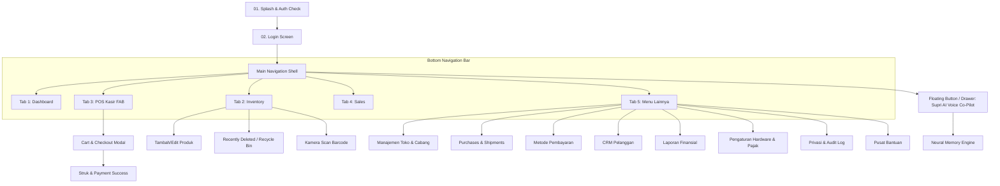

# Pakasir Vault — Mobile App Specification & Architecture Blueprint
> **Dokumen Panduan & Rekayasa Pengembangan Aplikasi Mobile**  
> **Target Platform:** Android & iOS (Cross-Platform via Flutter / React Native)  
> **Backend Service:** Laravel REST API + PostgreSQL (`pakasir`) + Gemini AI & Neural Memory Engine  
> **Versi Dokumen:** 1.0.0 (Production Blueprint)

---

## Daftar Isi
1. [Ringkasan Eksekutif & Visi Produk](#1-ringkasan-eksekutif--visi-produk)
2. [Rekomendasi Tech Stack & Arsitektur Mobile](#2-rekomendasi-tech-stack--arsitektur-mobile)
3. [Design System & UI/UX Mobile Guidelines](#3-design-system--uiux-mobile-guidelines)
4. [Arsitektur Navigasi & Struktur Layar (Information Architecture)](#4-arsitektur-navigasi--struktur-layar-information-architecture)
5. [Spesifikasi Fungsional Per Layar (Screen Specifications)](#5-spesifikasi-fungsional-per-layar-screen-specifications)
   - [5.1 Splash, Onboarding & Autentikasi](#51-splash-onboarding--autentikasi)
   - [5.2 Dashboard Eksekutif](#52-dashboard-eksekutif)
   - [5.3 Terminal Kasir POS (Fast Checkout)](#53-terminal-kasir-pos-fast-checkout)
   - [5.4 Manajemen Inventaris & Kontrol Stok](#54-manajemen-inventaris--kontrol-stok)
   - [5.5 Riwayat Transaksi & Penjualan (Sales)](#55-riwayat-transaksi--penjualan-sales)
   - [5.6 Pengadaan & Pelacakan Pengiriman (Purchases & Shipments)](#56-pengadaan--pelacakan-pengiriman-purchases--shipments)
   - [5.7 Kanal Pembayaran & Rekonsiliasi Kas (Payments)](#57-kanal-pembayaran--rekonsiliasi-kas-payments)
   - [5.8 CRM & Manajemen Pelanggan (Customers)](#58-crm--manajemen-pelanggan-customers)
   - [5.9 Manajemen Multi-Cabang Ritel (Store Outlets)](#59-manajemen-multi-cabang-ritel-store-outlets)
   - [5.10 Laporan Finansial & Arus Kas (Reports)](#510-laporan-finansial--arus-kas-reports)
   - [5.11 Supri AI Assistant & Percakapan Suara 2-Arah](#511-supri-ai-assistant--percakapan-suara-2-arah)
   - [5.12 Neural Memory Engine (Otak Bisnis AI)](#512-neural-memory-engine-otak-bisnis-ai)
   - [5.13 Pengaturan Sistem & Konfigurasi Hardware](#513-pengaturan-sistem--konfigurasi-hardware)
   - [5.14 Keamanan, Hak Akses & Audit Log](#514-keamanan-hak-akses--audit-log)
   - [5.15 Pusat Bantuan & Layanan Tiket (Help Center)](#515-pusat-bantuan--layanan-tiket-help-center)
6. [Integrasi Perangkat Keras Mobile (Native Hardware)](#6-integrasi-perangkat-keras-mobile-native-hardware)
7. [Kontrak Lengkap REST API Backend](#7-kontrak-lengkap-rest-api-backend)
8. [Skema Data & Entity Relationship (ERD Reference)](#8-skema-data--entity-relationship-erd-reference)
9. [Strategi Offline-First & Sinkronisasi Data](#9-strategi-offline-first--sinkronisasi-data)
10. [Roadmap & Checklist Milestone Pengembangan](#10-roadmap--checklist-milestone-pengembangan)

---

## 1. Ringkasan Eksekutif & Visi Produk

**Pakasir Vault** adalah platform Enterprise Point-of-Sale (POS) dan Smart Inventory SaaS yang dilengkapi asisten bisnis berbasis kecerdasan buatan (*Supri AI Assistant*) serta *Neural Memory Engine*.

Aplikasi mobile ini dirancang untuk:
1. **Pemilik Bisnis (Owner / Executive):** Memantau omzet harian multi-cabang, memantau stok kritis, menyetujui *purchase order*, melihat laba bersih riil, dan berdiskusi strategis bersama asisten suara AI secara *hands-free*.
2. **Kasir (Cashier):** Memproses pesanan kilat (*fast checkout*) dalam hitungan detik, memindai barcode menggunakan kamera ponsel, menerima pembayaran multi-metode (Cash, QRIS, Kartu), dan mencetak struk thermal via Bluetooth printer 58mm/80mm.
3. **Kepala Gudang (Warehouse Manager):** Mengelola keluar-masuk stok barang, memulihkan produk yang baru dihapus (*soft delete hold*), dan melakukan *batch restock* langsung dari genggaman.

---

## 2. Rekomendasi Tech Stack & Arsitektur Mobile

### 2.1 Pilihan Framework Mobile
| Parameter | Pilihan A: Flutter (Direkomendasikan) | Pilihan B: React Native (Expo) |
|---|---|---|
| **Bahasa** | Dart 3.x | TypeScript / JavaScript |
| **State Management** | Flutter Bloc atau Riverpod | Zustand + TanStack Query (React Query) |
| **Local Database** | Isar Database / Drift (SQLite) | WatermelonDB / SQLite (Expo SQLite) |
| **Bluetooth Thermal** | `esc_pos_utils` + `blue_thermal_printer` | `react-native-thermal-receipt-printer` |
| **Barcode Scanner** | `mobile_scanner` (Camera MLKit) | `expo-camera` / `vision-camera-code-scanner` |
| **Audio & Voice STT** | `speech_to_text` + `flutter_tts` + `record` | `expo-speech` + `@react-native-voice/voice` |
| **Styling** | ThemeData kustom (Clean Material 3 tokens) | NativeWind (Tailwind CSS v4) |

> **Catatan Rekayasa:** Basis web saat ini mengadopsi struktur komponen React yang selaras dengan arsitektur Flutter mobile sebelumnya (`pakasir2`). Menggunakan Flutter atau React Native keduanya sangat mudah mengadopsi kontrak data dan aturan bisnis yang sudah ada di repositori ini.

### 2.2 Arsitektur Pola (Clean Architecture)
```text
lib/ / src/
├── core/
│   ├── network/            # Dio / Axios HTTP Client + Interceptor Bearer Token
│   ├── theme/              # AppColors, AppTypography, AppRadius
│   ├── hardware/           # BluetoothPrinterService, BarcodeScannerService
│   ├── voice/              # VoiceSessionStateMachine (STT & TTS Controller)
│   └── database/           # SQLite / Offline Sync Manager
├── data/
│   ├── models/             # ProductModel, TransactionModel, OutletModel (JSON SerDe)
│   ├── datasources/        # RemoteApiDataSource & LocalCacheDataSource
│   └── repositories/       # Repository Implementations
├── domain/
│   ├── entities/           # Business entities murni
│   └── usecases/           # CheckoutUseCase, SoftDeleteUseCase, AskSupriUseCase
└── presentation/
    ├── navigation/         # BottomBarNav, AppRoutes, Guards
    ├── common_widgets/     # ProductIcon, KpiCard, StatusBadge, ButtonPrimary
    └── screens/            # 15 Layar Modul (Dashboard, POS, Inventory, dsb.)
```

---

## 3. Design System & UI/UX Mobile Guidelines

### 3.1 Color Palette & Design Tokens (Inventor Theme)
| Token Key | Nilai Hex | Fungsi / Penggunaan |
|---|---|---|
| `primaryNavy` | `#0F0F4A` | Warna Brand Utama, Tombol CTA Utama, Header Bar |
| `primaryNavyHover`| `#171764` | State pressed / active |
| `accentSkyBlue` | `#B9D9FA` | Aksen aktif tab navigasi, chip terpilih, focus border |
| `tableHeaderBg` | `#E8EEFB` | Latar belakang sub-header, card highlight |
| `chartLine` | `#4A7FB0` | Garis grafik performa sales velocity |
| `chartAreaFill` | `#EAF0FB` | Gradien pengisi area grafik |
| `appBg` | `#FAFAFA` | Background aplikasi (Off-white bersih) |
| `surface` | `#FFFFFF` | Latar belakang kartu, modal sheet, input field |
| `surfaceAlt` | `#F7F7F8` | Latar belakang KPI container & list item hover |
| `borderSubtle` | `#E5E7EB` | Garis tepi 1px pemisah border cards & list items |
| `textPrimary` | `#111827` | Teks utama, judul, harga (Near Black) |
| `textSecondary` | `#6B7280` | Deskripsi, SKU, label informasi pendukung |
| `textMuted` | `#9CA3AF` | Placeholder input, tanggal, caption sekunder |

#### Status Badges (Soft Tint + Saturated Text)
- **Positive / In Stock / Paid:** Background `#DDF5E5`, Teks/Dot `#1E9E4F`
- **Negative / Out of Stock / Cancelled:** Background `#FDE3E3`, Teks/Dot `#D83A3A`
- **Warning / Low Stock / Processing:** Background `#D6E8FB`, Teks/Dot `#2D6FB5`

#### Varian Dark Card (POS & Executive Highlight)
- Dark Card Background: `#181B1E` / `#111827`
- High-contrast Accent: `#D4E938` (Brand Lime Neon) untuk tombol Checkout Cepat & Indikator AI aktif.

### 3.2 Tipografi & Skala Spacing Mobile
- **Font Family:** `Inter` (Fallback: `system-ui` / `SF Pro` di iOS, `Roboto` di Android).
- **H1 - Judul Layar:** `20px / FontWeight.SemiBold (600)`
- **H2 - Judul Kartu / Modul:** `16px / FontWeight.Medium (500)`
- **Value Angka KPI:** `24px - 28px / FontWeight.Bold (700)`
- **Body Regular:** `13px / 14px / FontWeight.Regular (400)`
- **Caption & Meta:** `11px / 12px / FontWeight.Normal (400)`
- **Badge & Tag:** `10px / 11px / FontWeight.Medium (500)`
- **Corner Radius:**
  - Card & Button: `12px` (Mobile optimized)
  - Modals & Bottom Sheets: `20px` (Top-left & Top-right)
  - Status Pills: `999px` (Full Rounded)
- **Touch Target:** Seluruh tombol dan area klik minimal berukuran `48 × 48 dp` untuk ergonomi satu tangan (*thumb zone*).

---

## 4. Arsitektur Navigasi & Struktur Layar (Information Architecture)



### 4.1 Shell Navigasi Bawah (Bottom Navigation Bar)
1. **Dashboard** (`LayoutGrid` icon) — Tinjauan performa eksekutif harian.
2. **Inventory** (`Package` icon) — Katalog barang, kontrol stok, dan filter tag.
3. **POS Terminal** (*Floating Center Highlight Button* dengan icon `ShoppingCart` / `CreditCard`) — Tombol kasir kilat yang menonjol di tengah.
4. **Sales** (`FileText` icon) — Daftar pesanan penjualan dan status pembayaran.
5. **More** (`Menu` icon) — Akses ke Outlet, CRM, Finansial, Printer Setting, dan Bantuan.

---

## 5. Spesifikasi Fungsional Per Layar (Screen Specifications)

### 5.1 Splash, Onboarding & Autentikasi
- **Fungsi:** Validasi token sesi pengguna saat aplikasi dibuka, login multi-role (Owner, Kasir, Admin Gudang), dan opsi Biometric Login (Fingerprint / Face ID).
- **Elemen Layar:**
  - Logo Pakasir Vault dengan badge status server (Online / Offline Mode).
  - Form email & password.
  - Tombol login utama dengan haptic feedback.
  - Tombol cepat Biometric (jika perangkat mendukung).
  - Pilihan Server Base URL switcher (untuk deployment on-premise atau private cloud).
- **Aturan Bisnis:**
  - Token API disimpan di `EncryptedSharedPreferences` (Android) atau `Keychain` (iOS).
  - Role menentukan visibilitas tab (misal: Kasir hanya bisa membuka POS dan Sales).

---

### 5.2 Dashboard Eksekutif
- **Fungsi:** Memberikan pandangan 360 derajat atas kondisi bisnis dalam hitungan detik.
- **Komponen Utama (Mobile Stack Vertikal):**
  1. **Top Bar:** Salam personal pengguna, nama cabang aktif (`SCBD Flagship`), dan tombol toggle status buka/tutup toko.
  2. **4 KPI Quick Cards:**
     - **Total Penjualan:** Nilai omzet (misal: `Rp 45.420.000`) dengan badge delta `+20%`.
     - **Total Pengeluaran / Purchases:** Nilai pembelian inventaris dengan badge `-15%`.
     - **Total Produk Terdaftar:** Jumlah total SKU.
     - **Stok Kritis (Low/Out):** Indikator peringatan barang menipis.
  3. **Grafik Sales Velocity (7 Hari):** Visualisasi batang/garis interaktif yang menunjukkan omzet harian dengan penanda jam sibuk transaksi (*peak hours*).
  4. **Donut Ring Tingkat Ketersediaan Stok:**
     - In Stock (Navy `#0F0F4A`)
     - Low Stock (Sky Blue `#B9D9FA`)
     - Out of Stock (Pale Periwinkle `#E8EEFB`)
  5. **Daftar Peringatan Stok (Stock Alert Card):** Menampilkan 3 produk teratas yang perlu di-restock segera beserta tombol langsung *Restock Now*.
  6. **Aksi Cepat (Quick Action Bar):** Tombol pintas `+ Tambah Produk`, `Buka Kasir POS`, dan `Tanya Supri AI`.

---

### 5.3 Terminal Kasir POS (Fast Checkout)
- **Fungsi:** Inti operasional kasir untuk mencatat penjualan secepat mungkin dengan minimum ketukan layar.
- **Alur Kerja Pengguna:**
  1. **Pencarian Produk:**
     - Input pencarian cepat nama/SKU produk.
     - Tombol ikon kamera di sebelah kolom pencarian untuk membuka scanner barcode kilat.
     - Grid produk dengan gambar, nama, harga satuan, dan kuantitas sisa stok.
     - *Feedback visual:* Produk habis otomatis berstatus *disable* dengan badge *Out of Stock*.
  2. **Keranjang Belanja (Bottom Sheet Interaktif):**
     - Indikator melayang di bagian bawah layar: `X Item | Total Rp XXX.XXX` yang dapat di-swipe ke atas untuk membuka rincian pesanan.
     - Kontrol kuantitas instan: tombol `+` dan `-` per item, serta tombol *swipe-to-delete*.
     - Pemilihan Pelanggan: Dropdown pencarian pelanggan (`Walk-in Customer`, `Member VIP`, atau `Wholesale`).
  3. **Penyelesaian Pembayaran (Checkout Screen):**
     - Opsi Metode Pembayaran:
       - **Tunai (Cash):** Tombol pecahan uang pas (`Uang Pas`, `Rp 50.000`, `Rp 100.000`, `Rp 200.000`) dengan kalkulasi uang kembalian otomatis.
       - **QRIS Dinamis:** Menghasilkan QR code langsung di layar untuk dipindai pelanggan.
       - **Mesin EDC / Kartu:** Catat nomor otorisasi/approval code.
     - Pajak PPN (11%) dan Service Fee dikalkulasi otomatis sesuai setting toko.
  4. **Struk & Cetak Thermal:**
     - Pop-up sukses dengan animasi konfeti.
     - Tombol **Cetak Struk Thermal (ESC/POS)** via Bluetooth.
     - Tombol **Kirim Struk via WhatsApp** ke nomor handphone pelanggan.
     - Tombol **Transaksi Baru** yang mereset keranjang belanja.

---

### 5.4 Manajemen Inventaris & Kontrol Stok
- **Fungsi:** Mengontrol seluruh katalog barang dagangan, multi-gudang, dan siklus hidup produk.
- **Fitur Kunci:**
  - **Dua Tab Navigasi Atas:**
    1. **Aktif (Katalog Utama):** Daftar seluruh SKU yang aktif diperdagangkan.
    2. **Recently Deleted (Tempat Sampah Sementara):** Produk yang telah di-soft delete dan menunggu masa retensi (*grace period*) sebelum dihapus permanen.
  - **Filter Cepat (Horizontal Pill Carousel):** `Semua`, `Fast Moving`, `Regular`, `Discounted`, `Low Demand`, `Dead Items`, `Trending`.
  - **Kartu Produk Mobile:**
    - Ikon/foto produk.
    - Nama barang, kode SKU, dan nama kategori.
    - Harga jual dan estimasi margin kotor.
    - Bar indikator sisa stok (Hijau jika aman, Kuning jika `< 30`, Merah jika habis).
  - **Aksi Geser (Swipe Actions):**
    - Geser Kanan: Edit Cepat Stok (*Quick Add Stock*).
    - Geser Kiri: Pindahkan ke *Recently Deleted* dengan pilihan alasan penghapusan (Rusak, Kadaluarsa, Discontinue).
  - **Fitur Pulihkan (Restore):** Pada tab *Recently Deleted*, terdapat tombol *Restore* satu-klik untuk memulihkan SKU kembali ke katalog aktif.
  - **Tombol Tambah Produk (Floating Action Button):** Form ringkas input nama, SKU barcode, kategori, harga beli (HPP), harga jual, stok awal, dan gudang.

---

### 5.5 Riwayat Transaksi & Penjualan (Sales)
- **Fungsi:** Melacak setiap faktur penjualan yang telah diterbitkan oleh seluruh terminal kasir.
- **Elemen Layar:**
  - Filter Status: `Semua`, `Completed`, `Processing`, `Cancelled`.
  - Filter Rentang Tanggal (Hari ini, 7 Hari, 30 Hari, Kustom).
  - Ringkasan KPI: Omzet kotor, jumlah transaksi sukses, dan rata-rata nilai transaksi (*Average Order Value*).
  - Item List Transaksi: No. Faktur (misal: `INV-20261026-001`), waktu transaksi, nama kasir, metode pembayaran, dan nominal total.
  - Halaman Rincian Faktur:
    - Daftar rincian barang yang dibeli beserta subtotal.
    - Rincian diskon, PPN 11%, dan biaya layanan.
    - Tombol *Cetak Ulang Struk Thermal*.
    - Tombol *Refund / Batalkan Transaksi* (membutuhkan otorisasi PIN Manager).

---

### 5.6 Pengadaan & Pelacakan Pengiriman (Purchases & Shipments)
- **Fungsi:** Memonitor pesanan restock barang ke supplier dan melacak paket pengiriman logistik.
- **Fitur Kunci:**
  - Daftar Purchase Order (PO) dengan badge status (`Draft`, `Pending Approval`, `In Transit`, `Received`).
  - Total pengeluaran procurement bulan berjalan.
  - **Kartu "Still Not Arrived" (Keterlambatan Supplier):**
    - Peringatan jika barang belum tiba melewati estimasi tanggal (*ETA*).
    - Tombol **Hubungi WhatsApp Supplier** yang langsung membuka aplikasi WhatsApp dengan draf pesan otomatis: *"Halo [Nama Supplier], menanyakan status PO #[NoPO] atas produk [Nama Produk] yang terlambat tiba..."*.
  - Form Pembuatan PO Baru ke supplier terdaftar.

---

### 5.7 Kanal Pembayaran & Rekonsiliasi Kas (Payments)
- **Fungsi:** Mengatur gateway pembayaran digital dan mengontrol kas fisik di laci kasir (*cash drawer*).
- **Fitur Kunci:**
  - Switch on/off metode pembayaran yang diterima di kasir:
    - Kartu Debit/Kredit (Visa/Mastercard)
    - Virtual Account Bank (BCA, Mandiri, BRI)
    - E-Wallet & QRIS (GoPay, OVO, ShopeePay)
    - Uang Tunai (Cash)
  - Biaya transaksi (MDR) dan estimasi jadwal pencairan dana (*payout schedule*).
  - Fitur **Buka Kasir & Tutup Kasir (End of Day Reconciliation):**
    - Input modal kas awal saat shift dimulai.
    - Input hitungan fisik uang kas di laci saat shift berakhir.
    - Laporan selisih kas (*over/short balance*).

---

### 5.8 CRM & Manajemen Pelanggan (Customers)
- **Fungsi:** Mengelola data pelanggan setia, klasifikasi tier, dan riwayat belanja.
- **Fitur Kunci:**
  - Tab Segmentasi Pelanggan: `Semua`, `Wholesale B2B`, `Retail Direct`, `VIP / Key Accounts`.
  - Kartu Pelanggan: Nama, nomor telepon, badge tier, total nilai belanja seumur hidup (*Customer Lifetime Value* / LTV), dan tanggal transaksi terakhir.
  - Aksi Cepat: Tombol panggil telepon dan kirim pesan WhatsApp langsung ke pelanggan.
  - Form Pendaftaran Pelanggan Baru: Nama, nomor telepon, alamat email, kota, dan catatan preferensi.

---

### 5.9 Manajemen Multi-Cabang Ritel (Store Outlets)
- **Fungsi:** Monitoring operasional multi-outlet di berbagai kota secara real-time.
- **Fitur Kunci:**
  - Kartu Cabang Outlet:
    - Nama cabang (contoh: `SCBD Flagship`, `PVJ Bandung`, `Tunjungan Plaza`).
    - Alamat lengkap dan kontak manager cabang.
    - Jumlah kasir aktif dan jumlah staf yang bertugas.
    - Nilai penjualan harian (*Daily Sales*) dan bulanan.
  - **Tombol Saklar Darurat (Toggle Store Status):**
    - Opsi instan *Buka Toko* atau *Tutup Sementara* untuk mengontrol penerimaan pesanan di cabang bersangkutan.

---

### 5.10 Laporan Finansial & Arus Kas (Reports)
- **Fungsi:** Menyajikan metrik akuntansi manajerial lengkap untuk evaluasi laba rugi.
- **Rincian Data Finansial:**
  - **Omzet Bruto (Revenue):** Total uang masuk dari penjualan.
  - **HPP / Biaya Pokok Penjualan (COGS):** Total modal beli barang yang terjual.
  - **Laba Kotor (Gross Profit):** Omzet dikurangi HPP.
  - **Beban Operasional (Opex):** Biaya sewa, gaji karyawan, listrik, dsb.
  - **Laba Bersih Riil (Net Profit):** Laba akhir bersih bisnis.
  - **Kas di Tangan (Cash on Hand):** Total likuiditas tunai yang tersedia.
  - **Distribusi Alokasi Dana:**
    - Anggaran Restock Inventaris (35%)
    - Biaya Operasional Toko (25%)
    - Dana Cadangan Darurat (15%)
    - Laba Dibagi / Prive (25%)
  - **Tombol Ekspor:** Simpan Laporan dalam bentuk file CSV atau bagikan ringkasan PDF via aplikasi lain.

---

### 5.11 Supri AI Assistant & Percakapan Suara 2-Arah
- **Fungsi:** Co-pilot bisnis pintar bertenaga Google Gemini dengan kemampuan percakapan suara interaktif dalam Bahasa Indonesia.
- **Mode Tampilan:** Bottom Drawer yang dapat dipanggil dari mana saja melalui tombol melayang (*Floating Microphone Button*).
- **State Machine Sesi Suara 2-Arah:**
  ```text
  [Idle] 
    ↓ (User mengetuk ikon Mikrofon)
  [Greeting] → Supri menyapa secara audio: "Halo bos, mau bahas ide apa lagi nih?"
    ↓
  [Listening] → Mendengarkan suara pengguna via Native STT + Teks real-time melayang
    ↓
  [Processing] → Mengirim teks prompt ke Endpoint Backend Gemini dengan context riwayat
    ↓
  [Speaking] → Memutar audio jawaban Supri via Native TTS
    ↓ (Otomatis kembali mendengarkan)
  [Listening] ...
  ```
  *Kondisi Berakhir:* Pengguna mengetuk tombol stop, terjadi 2x giliran hening beruntun, atau pengguna menutup drawer.
- **Prompt Pintasan (Quick Chips):**
  - *"Restock stok kritis sekarang"*
  - *"Berapa laba bersih minggu ini?"*
  - *"Tampilkan produk fast selling"*
  - *"Ide konten promo TikTok & Reels"*
- **Rich Interactive Widgets di Dalam Chat:**
  - **Widget Restock Instan:** Menampilkan produk yang direkomendasikan untuk diisi ulang dengan tombol eksekusi *"Restock Now"* satu-klik di dalam chat bubble.
  - **Widget Finansial:** Kartu ringkasan omzet, laba kotor, dan laba bersih.
  - **Widget Strategi Pemasaran:** Rekomendasi kampanye media sosial berdasarkan barang lambat laku (*dead items*).

---

### 5.12 Neural Memory Engine (Otak Bisnis AI)
- **Fungsi:** Mengatur basis pengetahuan khusus toko agar AI Supri mengingat aturan bisnis tertentu dalam jangka panjang (hingga 6 bulan).
- **Fitur Kunci:**
  - Kategori Memori: `Kebijakan Finansial`, `Strategi Restock`, `Perilaku Pelanggan`, `Aturan Bisnis`.
  - Daftar Aturan yang Dipelajari: Menampilkan kunci aturan, nilai parameter, dan bobot kepentingan (*priority weight* 0.1 s/d 1.0).
  - Form Pelatihan Memori Baru (*Train New Rule*): Masukkan aturan khusus toko (misal: *"Jangan pernah restock produk X lebih dari 50 unit jika belum akhir pekan"*).
  - Tombol **Sinkronisasi Otak AI** ke basis data cloud PostgreSQL.

---

### 5.13 Pengaturan Sistem & Konfigurasi Hardware
- **Fungsi:** Mengatur identitas bisnis, parameter fiskal, dan integrasi perangkat keras eksternal.
- **Fitur Kunci:**
  - Profil Toko: Nama toko, nomor telepon, email, alamat.
  - Parameter Pajak & Mata Uang: Format Rupiah (`IDR`), PPN standar 11%, dan biaya layanan.
  - **Konfigurasi Printer Thermal Struk:**
    - Pilihan Tipe Sambungan: Bluetooth atau USB OTG.
    - Pemindaian Perangkat Bluetooth di sekitar.
    - Pilihan Ukuran Kertas: `58 mm` (Standar mobile) atau `80 mm` (Standar kasir desktop).
    - Tombol **Test Print Struk Sampel** untuk memastikan koneksi printer bekerja dengan sempurna.
  - Ambang Batas Stok Menipis (*Low Stock Alert Threshold*): Pengaturan angka peringatan (default: `< 20 unit`).
  - Suara & Feedback: Toggle bunyi beep saat barcode berhasil di-scan.

---

### 5.14 Keamanan, Hak Akses & Audit Log
- **Fungsi:** Memastikan keamanan sistem transaksi dan akuntabilitas tindakan staf.
- **Fitur Kunci:**
  - Indikator Postur Keamanan: Status enkripsi AES-256 data lokal, autentikasi 2FA, dan PIN Kasir.
  - **Log Audit Keamanan Real-time:** Menampilkan log aktivitas (misal: *"Kasir A mengubah harga produk produk SKU-01"*, *"Admin B menghapus 2 produk"*).
  - Tombol **Backup Database Lokal Sekarang** ke cloud storage.
  - Pengaturan PIN Otorisasi Khusus Supervisor untuk transaksi diskon besar atau pembatalan faktur (*void transaction*).

---

### 5.15 Pusat Bantuan & Layanan Tiket (Help Center)
- **Fungsi:** Menyediakan jawaban atas pertanyaan umum dan saluran pengaduan kendala teknis.
- **Fitur Kunci:**
  - Pencarian Tanya Jawab Cepat (FAQ) dengan akordeon per kategori (POS Kasir, Stok Barang, Supri AI, Masalah Printer Bluetooth).
  - Daftar Tiket Kendala Pengguna: Status tiket (`Open`, `In Progress`, `Resolved`).
  - Form Pengajuan Tiket Bantuan Baru dengan fitur lampiran tangkapan layar (*screenshot* kendala).

---

## 6. Integrasi Perangkat Keras Mobile (Native Hardware)

### 6.1 Printer Thermal Bluetooth (ESC/POS)
Format baku cetak struk kasir yang wajib diimplementasikan pada aplikasi mobile:
```text
================================
         PAKASIR VAULT          
       SCBD Flagship Store      
   Jl. Jend. Sudirman Kav. 52   
     Telp: +62 812-3456-7890    
================================
No. Faktur : INV-20261026-0042
Waktu      : 26/10/2026 14:35
Kasir      : Budi Santoso
Pelanggan  : Walk-in Customer
--------------------------------
1x Kopi Espresso        Rp 25.000
2x Croissant Butter     Rp 44.000
--------------------------------
Subtotal                Rp 69.000
PPN (11%)               Rp  7.590
--------------------------------
TOTAL AKHIR             Rp 76.590
Metode Bayar : QRIS Dinamis
Status       : LUNAS
================================
  Terima kasih atas kunjungan   
   Barang yang sudah dibeli     
  tidak dapat ditukar kembali   
================================
```
- **Karakter Lebar Kertas:**
  - `58 mm`: 32 karakter per baris font standar (`Font A`).
  - `80 mm`: 48 karakter per baris font standar (`Font A`).
- **Fitur Otomatis:** Perintah potong kertas otomatis (*Auto Paper Cut*) untuk printer yang memiliki modul cutter hardware.

### 6.2 Kamera Barcode / QR Scanner
- Mendukung format: `EAN-13`, `EAN-8`, `Code 128`, `Code 39`, `QR Code`.
- Suara konfirmasi *beep audio* dan haptic feedback bergetar singkat (`50ms`) saat kode berhasil dideteksi.
- Mode pemindaian beruntun (*Continuous Scan Mode*) untuk proses *stock opname* cepat di gudang.

### 6.3 Voice Engine (Speech-to-Text & Text-to-Speech)
- **STT (Speech to Text):**
  - Menggunakan API pengenal suara bawaan OS (`Google Speech Recognizer` di Android, `Apple SFSpeechRecognizer` di iOS) dengan locale `id-ID` (Bahasa Indonesia).
  - Mendukung fallback rekaman audio berbasis endpoint `POST /api/voice-transcribe` jika perangkat tidak memiliki engine offline.
- **TTS (Text to Speech):**
  - Pengucapan intonasi natural Bahasa Indonesia dengan kecepatan bicara `1.0x` dan nada natural.

---

## 7. Kontrak Lengkap REST API Backend

### 7.1 Konfigurasi Global & Autentikasi
- **Base URL Pengembangan:** `http://10.0.2.2:8000/api` (Android Emulator) atau `http://127.0.0.1:8000/api` (iOS Simulator / Local WiFi).
- **Header Standar:**
  ```http
  Accept: application/json
  Content-Type: application/json
  Authorization: Bearer <API_TOKEN>
  X-API-TOKEN: <API_TOKEN>
  ```

---

### 7.2 Daftar Endpoint API

#### 1. Autentikasi & Profil
| Method | Endpoint | Fungsi | Payload Utama |
|---|---|---|---|
| `POST` | `/auth/login` | Login user & dapatkan token sesi | `{"email": "admin@pakasir.local", "password": "secret"}` |
| `GET` | `/auth/me` | Dapatkan profil user yang sedang aktif | - |
| `POST` | `/auth/logout` | Hapus token sesi pengguna | - |

#### 2. Dashboard Eksekutif
| Method | Endpoint | Fungsi | Response Schema Utama |
|---|---|---|---|
| `GET` | `/dashboard` | Ambil seluruh ringkasan KPI, grafik sales, dan aktivitas | `{ "critical_stock": 2, "open_outlets": 4, "total_revenue": 45400000, "chart_velocity": [...], "top_products": [...] }` |

#### 3. Inventaris & Produk
| Method | Endpoint | Fungsi | Detail / Payload |
|---|---|---|---|
| `GET` | `/inventory` | Ambil katalog produk aktif (bisa filter `tag`, `category`, `search`) | Query params: `?status=active&tag=Fast Moving&search=kopi` |
| `GET` | `/inventory/recently-deleted` | Ambil daftar produk yang dalam masa penahanan *soft delete* | Menampilkan `daysRemaining`, `deleteAfter`, dan `deletedReason` |
| `POST` | `/inventory` | Tambah produk baru | `{"name": "...", "sku": "...", "category": "...", "price": 50000, "cost_price": 30000, "total_qty": 100, "stock_in": 100}` |
| `GET` | `/inventory/{id}` | Ambil rincian lengkap 1 produk | - |
| `PUT` | `/inventory/{id}` | Perbarui data produk | Field yang ingin diubah |
| `DELETE` | `/inventory/{id}` | Hapus langsung produk | - |
| `POST` | `/inventory/{id}/soft-delete`| Pindahkan produk ke *Recently Deleted* | `{"reason": "Discontinued"}` |
| `POST` | `/inventory/{id}/restore` | Pulihkan kembali produk yang terhapus | - |
| `POST` | `/inventory/batch-restock` | Tambah stok massal | `{"items": [{"product_id": 1, "qty": 50}]}` |
| `POST` | `/inventory/purge-expired` | Bersihkan produk yang masa hold-nya habis | - |
| `GET` | `/inventory/categories` | Ambil daftar kategori produk | Array kategori |

#### 4. Transaksi Kasir (POS)
| Method | Endpoint | Fungsi | Detail / Payload |
|---|---|---|---|
| `GET` | `/transactions` | Ambil riwayat seluruh transaksi penjualan | Paginated list (15 transaksi per halaman) |
| `POST` | `/transactions` | Simpan transaksi kasir & kurangi stok otomatis | `{"items": [{"product_id": 1, "quantity": 2}], "payment_method": "Cash", "customer_id": 1, "amount_paid": 100000}` |
| `GET` | `/transactions/{id}` | Detail rincian faktur transaksi | Mengembalikan relasi `items`, `customer`, `outlet` |

#### 5. Pelanggan (CRM)
| Method | Endpoint | Fungsi | Detail / Payload |
|---|---|---|---|
| `GET` | `/customers` | Ambil seluruh data pelanggan | Array pelanggan dengan LTV dan riwayat order |
| `POST` | `/customers` | Tambah pelanggan baru | `{"name": "...", "phone": "0812...", "email": "...", "tier": "VIP"}` |
| `DELETE` | `/customers/{id}` | Hapus data pelanggan | - |

#### 6. Manajemen Toko & Cabang (Store Outlets)
| Method | Endpoint | Fungsi | Detail / Payload |
|---|---|---|---|
| `GET` | `/stores` | Ambil daftar seluruh outlet cabang | Menampilkan status buka/tutup, omzet harian & staf |
| `POST` | `/stores` | Tambah cabang outlet baru | `{"name": "...", "code": "...", "city": "...", "address": "..."}` |
| `PATCH` | `/stores/{id}/toggle-status`| Ubah status buka / tutup cabang secara instan | - |

#### 7. Laporan Finansial & Akuntansi
| Method | Endpoint | Fungsi | Detail / Payload |
|---|---|---|---|
| `GET` | `/reports` | Ambil kalkulasi P&L (Omzet, HPP, Laba Bersih, Kas) | Ringkasan metrik akuntansi keuangan |
| `GET` | `/reports/export` | Download laporan keuangan format CSV | File attachment CSV |

#### 8. Supri AI Assistant & Voice Co-Pilot
| Method | Endpoint | Fungsi | Detail / Payload |
|---|---|---|---|
| `GET` | `/supri/history` | Ambil riwayat percakapan chat dengan Supri | Menampilkan percakapan terakhir |
| `POST` | `/supri/chat` | Kirim pesan chat teks atau input suara ke Gemini | `{"message": "Analisa omzet hari ini", "voiceMode": true, "history": [...]}` |
| `POST` | `/voice-transcribe` | Transkrip rekaman audio ke teks via server | Multipart audio blob / base64 |
| `POST` | `/supri/restock-now` | Eksekusi otomatis restock barang kritis | Menambahkan stok produk berstatus restock |
| `GET` | `/supri/memories` | Ambil aturan memori jangka panjang AI | Array memori dan kategori |
| `POST` | `/supri/train-memory` | Tambahkan aturan memori bisnis baru | `{"category": "Aturan Bisnis", "key": "Restock Margin", "value": "Minimal margin 25%"}` |
| `GET` | `/supri/sales-analysis` | Analisis mendalam penjualan dari AI | Ringkasan insight penjualan |

#### 9. Pengaturan & Hardware
| Method | Endpoint | Fungsi | Detail / Payload |
|---|---|---|---|
| `GET` | `/settings` | Ambil konfigurasi toko, printer, dan pajak | Objek setting aplikasi |
| `PUT` | `/settings` | Perbarui konfigurasi toko dan hardware | Data setting yang dimodifikasi |

#### 10. Keamanan & Privasi
| Method | Endpoint | Fungsi | Detail / Payload |
|---|---|---|---|
| `GET` | `/privacy` | Ambil status keamanan sistem | AES-256 status, 2FA status |
| `GET` | `/privacy/audit-logs` | Ambil log audit aktivitas user | Log aktivitas terperinci |
| `POST` | `/privacy/toggle-security`| Toggle fitur proteksi keamanan | `{"feature": "two_factor"}` |
| `POST` | `/privacy/backup` | Eksekusi backup database cloud | - |

#### 11. Bantuan & FAQ
| Method | Endpoint | Fungsi | Detail / Payload |
|---|---|---|---|
| `GET` | `/help/faqs` | Ambil daftar tanya jawab umum FAQ | Array FAQ terkelompok |
| `GET` | `/help/tickets` | Ambil daftar tiket support kendala | Status tiket pengguna |
| `POST` | `/help/tickets` | Ajukan tiket pengaduan baru | `{"subject": "...", "description": "...", "priority": "high"}` |

---

## 8. Skema Data & Entity Relationship (ERD Reference)

Berikut adalah struktur model relasional inti database PostgreSQL:

```text
+------------------+       +-------------------+       +--------------------+
|    businesses    |1     *|   store_outlets   |1     *|    transactions    |
+------------------+-------+-------------------+-------+--------------------+
| id               |       | id                |       | id                 |
| name             |       | business_id (FK)  |       | store_outlet_id(FK)|
| email            |       | name              |       | customer_id (FK)   |
| currency         |       | code              |       | invoice_number     |
| tax_rate         |       | city, address     |       | subtotal, discount |
+------------------+       | is_open (boolean) |       | tax_amount, total  |
        | 1                | daily_sales       |       | payment_method     |
        |                  +-------------------+       | transaction_date   |
        | *                                            +--------------------+
+------------------+                                             | 1
|     products     |                                             |
+------------------+                                             | *
| id               |                                   +--------------------+
| business_id (FK) |                                   | transaction_items  |
| category_id (FK) |                                   +--------------------+
| name, sku        |                                   | id                 |
| price, cost_price|                                   | transaction_id(FK) |
| total_qty        |                                   | product_id (FK)    |
| stock_in         |                                   | quantity           |
| tag, image_asset |                                   | unit_price         |
| is_out_of_stock  |                                   | subtotal           |
| deleted_at       |                                   +--------------------+
| delete_after     |
| deleted_reason   |
+------------------+
```

---

## 9. Strategi Offline-First & Sinkronisasi Data

Karena kasir ritel tidak boleh terhenti saat koneksi internet terputus, aplikasi mobile **wajib** mengadopsi prinsip kerja *Offline-First*:

1. **Penyimpanan Lokal (Local Mirror Database):**
   - Menggunakan SQLite atau Isar Database pada perangkat mobile untuk menyimpan katalog produk, pelanggan, dan riwayat transaksi 30 hari terakhir.
   - Saat aplikasi online, lakukan sinkronisasi delta berkala (*background sync*).
2. **Antrian Transaksi Offline (Offline Mutation Queue):**
   - Transaksi kasir saat offline tetap tersimpan di database lokal dengan flag `sync_status: 'pending'`.
   - Stok barang di database lokal langsung didekremen saat itu juga agar kasir tahu sisa stok riil.
   - Struk thermal tetap bisa dicetak langsung via Bluetooth secara lokal tanpa internet.
3. **Penyelarasan Otomatis (Reconnection Sync):**
   - Ketika koneksi internet kembali aktif (`ConnectivityStatus == online`), background worker mengirim antrian transaksi offline secara berurutan (*FIFO*) ke endpoint `POST /api/transactions`.
   - Server memproses transaksi dan mengembalikan konfirmasi nomor faktur permanen.

---

## 10. Roadmap & Checklist Milestone Pengembangan

### Sprint 1: Pondasi, Auth & Navigasi Dasar (Minggu 1)
- [x] Setup repository Flutter / React Native dengan arsitektur Clean Code.
- [x] Setup theme tokens (`AppColors`, `AppTypography`, `AppRadius`) sesuai Inventor design system.
- [x] Layar Login & Autentikasi API terhubung ke `POST /api/auth/login`.
- [x] Navigasi dasar: Bottom Navigation Bar & Drawer.

### Sprint 2: Katalog Inventaris & Pemindai Barcode (Minggu 2)
- [x] Layar Katalog Produk dengan infinite scroll & filter tags.
- [x] Integrasi kamera native untuk Barcode/QR Code Scanner.
- [x] Fitur *Recently Deleted* (Soft Delete, Countdown Masa Retensi, Restore).
- [x] Form Tambah & Edit Produk baru terhubung ke REST API.

### Sprint 3: Terminal Kasir POS & Bluetooth Thermal Printer (Minggu 3)
- [x] Antarmuka POS Kasir: Grid katalog, pencarian cepat, dan keranjang belanja melayang.
- [x] Kalkulator uang kembalian tunai & pemilihan metode bayar (Cash, QRIS, Card).
- [x] Integrasi driver ESC/POS Bluetooth Thermal Printer (ukuran kertas 58mm & 80mm).
- [x] Fitur Cetak Struk dan Kirim Struk via WhatsApp.

### Sprint 4: Penjualan, CRM & Manajemen Multi-Cabang (Minggu 4)
- [x] Layar Riwayat Transaksi Penjualan, Filter status & rincian faktur.
- [x] Layar CRM Pelanggan (Tier VIP/Wholesale, CLV, panggil/WA pelanggan).
- [x] Layar Monitoring Cabang (Buka/Tutup toko secara real-time).
- [x] Layar Pengadaan (PO) & Tombol WhatsApp Supplier atas keterlambatan paket.

### Sprint 5: Supri AI Voice Assistant & Neural Memory Engine (Minggu 5)
- [x] Integrasi mikrofon & state machine sesi suara 2-arah (STT & TTS Bahasa Indonesia).
- [x] Integrasi chat Gemini AI via backend endpoint `/api/supri/chat`.
- [x] Rich widget interaktif dalam chat (Restock Now, Ringkasan Finansial).
- [x] Modal Pelatihan Neural Memory Engine & Sinkronisasi aturan bisnis.

### Sprint 6: Laporan Finansial, Offline-Sync & Quality Assurance (Minggu 6)
- [x] Layar Laporan Finansial (Omzet, HPP, Laba Bersih, Kas di Tangan, Ekspor CSV).
- [x] Mekanisme antrian transaksi kasir offline (*Offline-First SQLite Queue*).
- [x] Layar Pengaturan Sistem, Biometric Authentication, dan Audit Log.
- [x] End-to-end testing di perangkat Android dan iOS fisik.
- [x] Rilis build APK/AAB dan TestFlight IPA.

---

> **Dokumen ini dibuat otomatis sebagai acuan teknis standar untuk pengembang mobile Pakasir Vault.** Seluruh komponen, kontrak endpoint, dan token visual dalam panduan ini sepenuhnya kompatibel dengan kode sumber React frontend dan Laravel backend yang ada pada repositori ini.
